<!-- The stats cards in ./profile/ are generated daily by .github/workflows/readme-cards.yml -->

<h1 align="center">Hi, I'm Abdullah 👋 <br> مرحباً، أنا عبدالله</h1>

<p align="center">
  <b>Independent developer from Palestine 🇵🇸</b><br>
  I build mobile apps with Flutter, write Python, Java and C++, and I'm leveling up in modern web development.
</p>

<p align="center">
  <a href="https://github.com/abdullahayyad?tab=followers"></a>
  
</p>

---

## 🧑‍💻 About me

```python
class Abdullah:
    role      = "Independent Developer & Builder"
    based_in  = "Palestine 🇵🇸"
    speaks    = ["Arabic", "English"]
    code      = ["Python", "Java", "C++", "Dart", "Swift"]
    building  = ["Flutter mobile apps", "Google Maps & Firebase integrations"]
    learning  = ["Modern web development"]
    off_hours = ["Electronics", "Creative coding", "Gaming"]

    def say_hi(self):
        return "Open to freelance work & collaborations — let's talk!"
```

## 🛠️ Tech stack

<p align="center">
  <a href="https://skillicons.dev">
    
  </a>
</p>

## 🚀 Featured projects

| Project | What it does | Stack |
|---|---|---|
| [**VPN App UI**](https://github.com/abdullahayyad/vpn_design) | Classic-style VPN app interface in Flutter, set up for mobile, web and desktop | Flutter · Dart |
| [**Clean Architecture + MVVM**](https://github.com/abdullahayyad/clean_architecture) | Flutter movie app built with Clean Architecture and MVVM on TheMovieDB API | Flutter · Dart |
| [**iOS Clean Architecture Sample**](https://github.com/abdullahayyad/IOS-Swift-CleanArchitecture-Sample) | Swift project structured with Clean Architecture, with unit tests, UI tests and SwiftLint | Swift · iOS |

## 📊 GitHub stats

<p align="center">
  <picture>
    <source media="(prefers-color-scheme: dark)" srcset="./profile/stats-dark.svg">
    
  </picture>
  <picture>
    <source media="(prefers-color-scheme: dark)" srcset="./profile/top-langs-dark.svg">
    
  </picture>
</p>

---

<p align="center">⭐ If something I built helped you, a star means a lot!</p>
